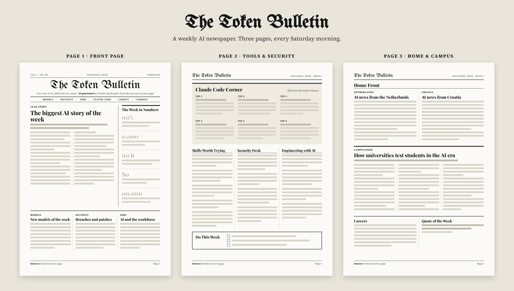

# The Token Bulletin

A weekly AI newspaper for people who build software. Every Saturday morning a new 3-page A4 issue lands here as a PDF, ready to read on screen or print.



## What's inside every issue

| Page | Sections |
|------|----------|
| **1 · Front page** | Lead story of the week · The Week in Numbers · Models · Security · Jobs |
| **2 · Tools & Security** | Claude Code Corner · Skills Worth Trying · Security Desk · Engineering with AI · Do This Week |
| **3 · Home & Campus** | Home Front (AI news from the Netherlands and Croatia) · Campus Desk · Careers · Quote of the Week |

A section is skipped in weeks without verified news for it. No news is better than made-up news.

## Read it

- **Archive page:** https://bornamilkovic.github.io/token-bulletin/
- **All issues:** the [`papers`](papers) folder, one folder per year

```
papers/
└── 2026/
    ├── tb-2026-44.pdf
    ├── tb-2026-45.pdf
    └── ...
```

Files are named `tb-<year>-<week>.pdf`, using the ISO week number of the Saturday the issue comes out.

## How it's made

**AI-generated:** every issue is written by Claude (Anthropic) from public sources, which are listed at the foot of each page. Only facts found in those sources make it in. It can still contain mistakes, so check the sources before relying on anything.

Curated by Borna Milković.
